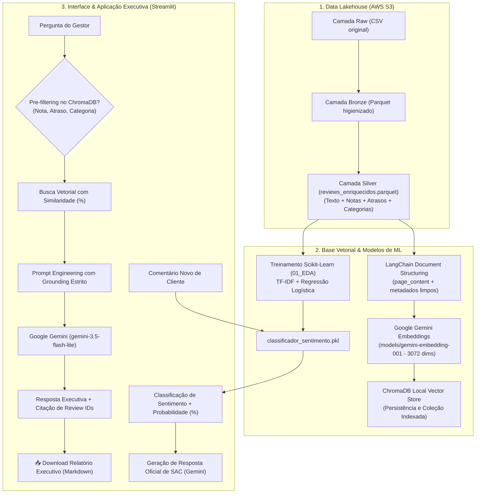

# 🎯 Tech Challenge - Fase 4: Voice of Customer Intelligence com RAG
**FIAP - Pós-Tech em Inteligência Artificial e Ciência de Dados**

Solução completa de **Voice of Customer (VoC)** e **Customer Experience (CX)** combinando **Retrieval-Augmented Generation (RAG)**, Machine Learning clássico de NLP (**TF-IDF + Scikit-Learn**), armazenamento analítico na **AWS S3**, banco vetorial **ChromaDB**, orquestração com **LangChain** e modelos generativos **Google Gemini**.

---

## 📌 1. Visão Geral do Problema de Negócio

Empresas de e-commerce recebem diariamente dezenas de milhares de avaliações textuais contendo dores, elogios, frustrações com entregas e feedbacks sobre produtos. Embora as notas quantitativas (1 a 5 estrelas) apontem oscilações de satisfação, a **causa raiz** desses sentimentos reside nos dados textuais não estruturados.

### O Desafio
Permitir que gestores, diretores e analistas realizem perguntas analíticas em linguagem natural e recebam:
1. **Respostas executivas fundamentadas estritamente em avaliações reais de clientes**, acompanhadas dos identificadores das evidências (`review_id`) e scores de relevância semântica (%);
2. **Triagem e classificação automática de novos comentários** em tempo real via modelo de Machine Learning;
3. **Geração assistida de respostas empáticas de SAC** para atendimento direto ao consumidor.

---

## 🏛️ 2. Arquitetura da Solução

O pipeline é composto por uma arquitetura moderna dividida em ingestão analítica (Data Lakehouse) e sistema de recuperação aumentada por IA generativa:



---

## 🛠️ 3. Tecnologias e Bibliotecas Utilizadas

| Componente | Tecnologia | Finalidade Técnica |
| :--- | :--- | :--- |
| **Interface Executiva** | `Streamlit` (v1.35+) | Aplicação Web com abas de RAG, Simulador de SAC e exportação de relatórios |
| **Orquestrador de IA** | `LangChain` (v1.4+) | Padronização com LCEL, Document abstractions e encadeamento |
| **Banco Vetorial** | `ChromaDB` (`langchain-chroma`) | Armazenamento local persistente e suporte nativo a filtros de metadados |
| **Embeddings** | `Google Gemini` (`gemini-embedding-001`) | Vetorização semântica densa de 3.072 dimensões com suporte a PT-BR |
| **LLM (Geração)** | `Google Gemini` (`gemini-3.5-flash-lite`) | Inferência ultra-rápida (~1.5s), baixo custo e alta fidelidade contextual |
| **Classificador de Sentimento** | `Scikit-Learn` (`TfidfVectorizer` + `LogisticRegression`) | Classificação de avaliações em tempo real treinada no EDA |
| **Armazenamento Nuvem** | `AWS S3` (`boto3`) | Arquitetura Medalhão: camadas Raw, Bronze e Silver |
| **Processamento Dados** | `Pandas`, `PyArrow`, `FastParquet` | Manipulação tabular e armazenamento colunar otimizado |
| **Engenharia de Texto** | `NLTK`, `Unidecode` | Stemming em português (RSLP) e higienização comparativa |

---

## 🧬 4. Engenharia e Preparação da Base (Camada Silver)

No notebook [`fase_4/notebooks/01_EDA.ipynb`](fase_4/notebooks/01_EDA.ipynb), foi realizada a unificação relacional dos dados e enriquecimento dos comentários:

1. **Seleção e Junção Relacional**:
   - `olist_order_reviews_dataset` combinado com `olist_orders_dataset`, `olist_order_items_dataset` e `olist_products_dataset`.
2. **Engenharia de Features Logísticas**:
   - Cálculo de `dias_atraso` (`order_delivered_customer_date` vs `order_estimated_delivery_date`).
   - Criação da flag booleana `entregue_com_atraso`.
3. **Tratamento de Texto**:
   - Concatenação do título da avaliação (`review_comment_title`) com o corpo da mensagem (`review_comment_message`), criando a coluna `review_rag`.
   - Limpeza de nulos e valores ausentes nas categorias e datas.
4. **Decisão Técnica Fundamental (NLP Clássico vs. RAG)**:
   - Foram testados tratamentos clássicos de NLP (remoção de stopwords, pontuação, acentuação e stemming RSLP no `tratamento_5`).
   - O `tratamento_5` foi utilizado para treinar o classificador do Scikit-Learn com alta acurácia.
   - **Justificativa da escolha para o RAG:** Para o banco vetorial, foi preservado o **texto natural completo** (`review_rag`). Modelos neurais modernos de embeddings dependem da sintaxe e palavras de ligação para capturar sentimento e semântica reais.

---

## 🎯 5. Funcionalidades do Aplicativo Streamlit

O aplicativo [`app.py`](app.py) conta com duas áreas de negócio:

### Aba 1: 💬 Voice of Customer RAG
- **Filtros Contextuais de Metadados (Pre-filtering):** Segmentação cirúrgica por notas (ex: apenas 1 e 2 estrelas para análise de churn), pedidos com atraso logístico e categorias de produto.
- **Transparência e Auditoria:** Cada evidência recuperada exibe a nota do cliente, se houve atraso, o `review_id` e a **barra de relevância semântica (%)** calculada a partir da distância vetorial.
- **Exportação de Relatórios:** Botão para download de um **Relatório Executivo em Markdown** consolidando o insight gerado e as avaliações que o fundamentaram.

### Aba 2: 🧪 Simulador de SAC & Triagem de Sentimento
- Entrada de qualquer texto inédito de cliente.
- Classificação instantânea via modelo Scikit-Learn (`classificador_sentimento.pkl`).
- **Geração de Resposta Humanizada de SAC:** O Google Gemini redige um e-mail de atendimento personalizado e empático pronto para envio ao cliente.

---

## 🚀 6. Instruções para Instalação e Execução

### Pré-requisitos
- Python 3.10 ou superior
- Chave gratuita `GOOGLE_API_KEY` do Google AI Studio
- Credenciais da AWS no `.env`

### Passo a Passo

1. **Clone o repositório:**
   ```bash
   git clone https://github.com/LucasRuizMartins/fiap_tech_challenge_04.git
   cd tech_challenge_04
   ```

2. **Crie e ative um ambiente virtual:**
   ```bash
   python -m venv venv
   # No Windows:
   .\venv\Scripts\activate
   # No Linux/Mac:
   source venv/bin/activate
   ```

3. **Instale as dependências:**
   ```bash
   pip install -r requirements.txt
   ```

4. **Configuração de Variáveis de Ambiente (`.env`) e API do Google Gemini:**

   O projeto utiliza o padrão da indústria com a biblioteca `python-dotenv`, mantendo credenciais e segredos fora do controle de versão (`.gitignore`).

   #### 🔑 Como Obter a Chave Gratuita da API do Google Gemini:
   1. Acesse o portal oficial para desenvolvedores: [Google AI Studio (aistudio.google.com)](https://aistudio.google.com/).
   2. Faça login com a sua conta Google.
   3. No menu lateral esquerdo, clique no botão **"Get API key"**.
   4. Clique em **"Create API key"** (selecione um projeto existente ou crie um novo projeto padrão).
   5. Copie a chave gerada (iniciada normalmente por `AIzaSy...`).

   #### ⚙️ Como Configurar o arquivo `.env`:
   Na raiz do projeto, existe um arquivo modelo chamado `.env.example`. Crie uma cópia dele com o nome exato `.env`:
   - No terminal (Linux / MacOS / PowerShell):
     ```bash
     cp .env.example .env
     ```
   - Ou pelo VS Code / Windows Explorer: clique com o botão direito em `.env.example`, copie, cole e renomeie para `.env`.

   Abra o arquivo `.env` e preencha as variáveis:
   ```dotenv
   # ==============================================================================
   # IA GENERATIVA & GOOGLE GEMINI (Obrigatório para o RAG e Simulador de SAC)
   # ==============================================================================
   GOOGLE_API_KEY=AIzaSySuaChaveAquiDoGoogleAIStudio
   GEMINI_CHAT_MODEL=gemini-3.5-flash-lite

   # ==============================================================================
   # ARMAZENAMENTO EM NUVEM AWS S3 (Necessário para download e ETL das bases)
   # ==============================================================================
   AWS_REGION=us-east-1
   AWS_ACCESS_KEY_ID=sua_access_key_da_aws
   AWS_SECRET_ACCESS_KEY=sua_secret_key_da_aws
   BUCKET_NAME=postech-challenge-datascience-004
   ```

   > 💡 **Nota de Segurança:** O arquivo `.env` contém suas credenciais privadas e já está incluído no `.gitignore`. Nunca envie o arquivo `.env` para o repositório público do GitHub! Apenas o `.env.example` deve ser commitado.

5. **Execução da Aplicação Web:**
   ```bash
   streamlit run app.py
   ```

---

## 📁 7. Estrutura do Repositório

```text
├── .env.example              <- Exemplo de variáveis de ambiente
├── requirements.txt          <- Dependências completas do projeto
├── README.md                 <- Documentação completa da solução
├── app.py                    <- Interface Web Executiva no Streamlit (RAG + SAC)
├── src/
│   ├── __init__.py
│   ├── utils.py              <- Funções de integração com AWS S3 (download/upload Parquet)
│   └── rag.py                <- Módulo central de RAG, Vector Store, Classificador e Gemini
└── fase_4/
    ├── docs/
    │   └── [IAST] - Tech Challenge - Fase 4.pdf <- Edital oficial da FIAP
    ├── models/
    │   ├── chroma_db/                  <- Base vetorial ChromaDB indexada
    │   └── classificador_sentimento.pkl <- Modelo Scikit-Learn treinado no EDA
    └── notebooks/
        ├── 00_s3.ipynb       <- Ingestão no S3 (Raw e Bronze)
        ├── 01_EDA.ipynb      <- Limpeza, engenharia de dados e treino do modelo ML
        └── 01_rag.ipynb      <- Pipeline RAG experimental (LangChain + Chroma + Gemini)
```

---

## 🎥 8. Vídeo de Apresentação
- **Link do Vídeo:** [Adicionar Link do YouTube / Loom]
- **Duração Máxima:** 7 minutos.
- **Roteiro sugerido:**
  1. *Introdução (1 min):* O problema de Voice of Customer e arquitetura geral (S3, Chroma, Gemini).
  2. *Engenharia de Dados & EDA (2 min):* Limpeza dos textos, pipeline medalhão e treino do modelo de Machine Learning clássico.
  3. *Demonstração Prática no Streamlit (3 min):*
     - Aba 1: Perguntas estratégicas de negócio, filtros de notas/atraso e citação dos Review IDs com relevância %.
     - Aba 2: Simulação de uma queixa nova, classificação com Scikit-Learn e geração da resposta de SAC com Gemini.
  4. *Conclusão (1 min):* Decisões técnicas e impacto para tomadores de decisão.
