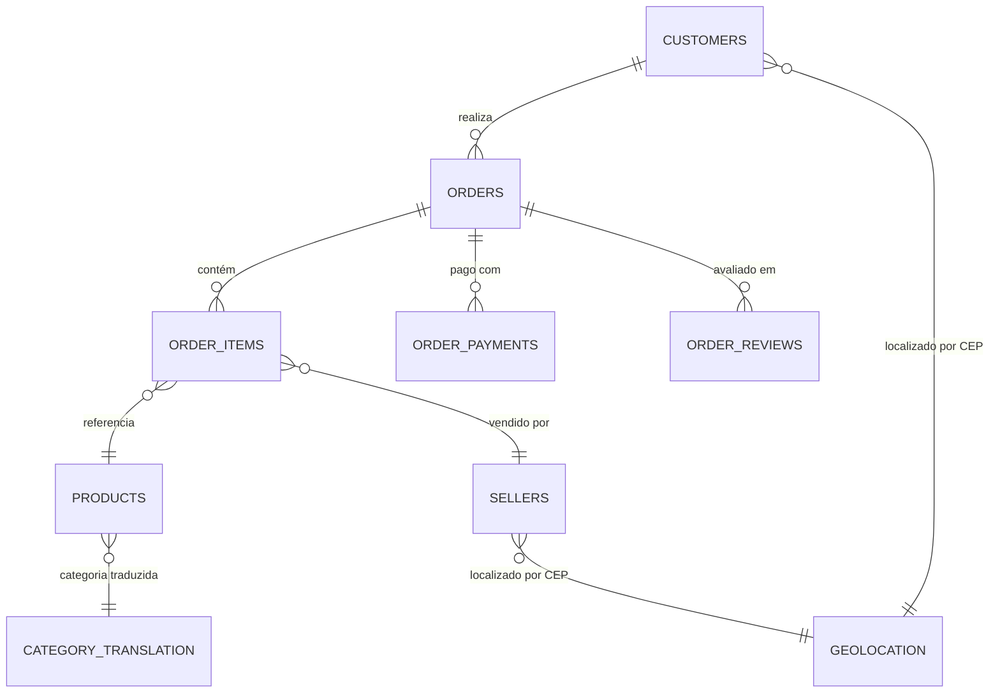

# Tech Challenge - Fase 4 (FIAP - Pós-Tech AI Scientist)

Pipeline de Engenharia de Dados e Machine Learning utilizando a base de e-commerce brasileiro da **Olist** integrada ao **AWS S3** nas camadas **Raw** (CSV) e **Bronze** (Parquet).

---

## 🏗️ Arquitetura do Data Lake (AWS S3)

O projeto adota os princípios da arquitetura medalhão integrada ao Amazon S3:

- **Camada Raw (`s3://<bucket>/raw/`)**: Armazena os dados brutos originais em formato `.csv` baixados do Kaggle (`olistbr/brazilian-ecommerce`).
- **Camada Bronze (`s3://<bucket>/bronze/`)**: Armazena os datasets higienizados e convertidos para formato colunar de alta performance `.parquet` via `src.utils.salvar_parquet_s3`.

---

## 📊 Modelo de Dados e Relacionamentos (Olist E-Commerce)

O ecossistema é centrado no **pedido (`orders`)**, que conecta clientes, itens comprados, lojistas/vendedores, produtos, pagamentos e avaliações:



---

## 📋 Dicionário das Bases de Dados

### 1. `olist_orders_dataset` (Pedidos) — *Tabela Central*
Representa a transação de compra e rastreia todo o ciclo de vida do pedido.
- **Chave Primária**: `order_id`
- **Chave Estrangeira**: `customer_id`
- **Colunas Principais**:
  - `order_status`: Status atual do pedido (`delivered`, `shipped`, `canceled`, `invoiced`, `processing`, etc.).
  - `order_purchase_timestamp`: Data e hora da compra.
  - `order_approved_at`: Data e hora da aprovação do pagamento.
  - `order_delivered_carrier_date`: Data de postagem/despacho para a transportadora.
  - `order_delivered_customer_date`: Data real da entrega final ao cliente.
  - `order_estimated_delivery_date`: Data estimada de entrega informada na compra.
- 💡 **Aplicações em Data Science**: Previsão de atrasos de entrega (SLA), análise de gargalos logísticos, sazonalidade e taxa de cancelamentos.

---

### 2. `olist_customers_dataset` (Clientes)
Contém dados cadastrais e de localização dos compradores.
- **Chave Primária**: `customer_id`
- **Colunas Principais**:
  - `customer_id`: Identificador gerado por pedido (cada pedido tem um `customer_id` único).
  - `customer_unique_id`: Identificador único da pessoa/cliente (permite rastrear compras recorrentes do mesmo usuário).
  - `customer_zip_code_prefix`: Primeiros 5 dígitos do CEP do cliente.
  - `customer_city` / `customer_state`: Cidade e estado do comprador.
- ⚠️ **Atenção**: Para análises de **LTV, Recorrência, Churn ou RFM**, utilize sempre `customer_unique_id`.

---

### 3. `olist_order_items_dataset` (Itens do Pedido)
Detalhamento de cada produto individual contido dentro de um pedido.
- **Chave Composta**: (`order_id`, `order_item_id`)
- **Chaves Estrangeiras**: `product_id`, `seller_id`
- **Colunas Principais**:
  - `order_item_id`: Sequencial do item no pedido (1, 2, 3...).
  - `price`: Preço de venda do item.
  - `freight_value`: Valor do frete cobrado por aquele item.
  - `shipping_limit_date`: Data limite para o lojista despachar o produto.
- 💡 **Aplicações em Data Science**: Elasticidade de preço, ticket médio por item, proporção frete vs. valor do produto.

---

### 4. `olist_order_payments_dataset` (Pagamentos)
Formas e condições de pagamento utilizadas para quitar o pedido.
- **Chave Estrangeira**: `order_id`
- **Colunas Principais**:
  - `payment_sequential`: Sequência dos métodos de pagamento usados no mesmo pedido.
  - `payment_type`: Método de pagamento (`credit_card`, `boleto`, `voucher`, `debit_card`).
  - `payment_installments`: Número de parcelas escolhido.
  - `payment_value`: Valor total pago com aquele método.
- 💡 **Aplicações em Data Science**: Análise de inadimplência, preferência de meios de pagamento e impacto do parcelamento no ticket médio.

---

### 5. `olist_order_reviews_dataset` (Avaliações / Feedback)
Pesquisa de satisfação e comentários pós-entrega respondidos pelos compradores.
- **Chave Primária**: `review_id`
- **Chave Estrangeira**: `order_id`
- **Colunas Principais**:
  - `review_score`: Nota de satisfação de **1 a 5**.
  - `review_comment_title`: Título da avaliação.
  - `review_comment_message`: Mensagem em texto livre com a avaliação.
  - `review_creation_date` / `review_answer_timestamp`: Datas de envio da pesquisa e resposta do cliente.
- 💡 **Aplicações em Data Science**: Processamento de Linguagem Natural (NLP), Análise de Sentimentos, correlação entre atraso de entrega e notas baixas.

---

### 6. `olist_products_dataset` (Catálogo de Produtos)
Atributos físicos, volumétricos e categorização dos itens comercializados.
- **Chave Primária**: `product_id`
- **Colunas Principais**:
  - `product_category_name`: Categoria do produto em português (ex: `beleza_saude`, `cama_mesa_banho`).
  - `product_name_lenght` / `product_description_lenght`: Tamanho em caracteres do título e descrição.
  - `product_photos_qty`: Quantidade de fotos publicadas no anúncio.
  - `product_weight_g`, `product_length_cm`, `product_height_cm`, `product_width_cm`: Peso e dimensões cúbicas.
- 💡 **Aplicações em Data Science**: Sistemas de recomendação, clusterização de produtos e cálculo de frete cubado.

---

### 7. `olist_sellers_dataset` (Vendedores / Lojistas)
Informações sobre os lojistas parceiros cadastrados na plataforma Olist.
- **Chave Primária**: `seller_id`
- **Colunas Principais**:
  - `seller_zip_code_prefix`: Prefixo do CEP do vendedor (origem do frete).
  - `seller_city` / `seller_state`: Cidade e estado de origem do vendedor.
- 💡 **Aplicações em Data Science**: Monitoramento de SLA por vendedor, concentração de lojistas por estado e cálculo de distância de entrega.

---

### 8. `olist_geolocation_dataset` (Geolocalização)
Mapeamento geográfico de CEPs brasileiros com coordenadas de latitude e longitude.
- **Chave**: `geolocation_zip_code_prefix`
- **Colunas Principais**:
  - `geolocation_lat`, `geolocation_lng`: Latitude e longitude.
  - `geolocation_city`, `geolocation_state`: Município e estado normalizados.
- 💡 **Aplicações em Data Science**: Mapas geoespaciais (Folium/Plotly) e cálculo de distância geodésica (Haversine) entre comprador e vendedor.

---

### 9. `product_category_name_translation.csv` (Dicionário de Categorias)
Tabela de referência para tradução dos nomes de categorias de produtos.
- **Colunas**:
  - `product_category_name`: Nome da categoria em português.
  - `product_category_name_english`: Tradução correspondente em inglês (ex: `health_beauty`, `bed_bath_table`).

---

## 🚀 Como Executar os Notebooks

1. Configure as variáveis da AWS no arquivo `.env`:
   ```bash
   AWS_REGION='us-east-1'
   AWS_ACCESS_KEY_ID='<sua-chave>'
   AWS_SECRET_ACCESS_KEY='<seu-secret>'
   BUCKET_NAME='postech-challenge-datascience-004'
   ```
2. **Upload e Conversão para S3**:
   - Abra e execute o notebook [`fase_4/notebooks/s3.ipynb`](fase_4/notebooks/s3.ipynb) para baixar a base do Kaggle e enviá-la para as camadas `raw/` e `bronze/`.
3. **Análise Exploratória (EDA)**:
   - Abra e execute o notebook [`fase_4/notebooks/EDA.ipynb`](fase_4/notebooks/EDA.ipynb) para listar o catálogo S3, carregar os Parquets e analisar as estatísticas das tabelas.

---

## 📁 Estrutura do Repositório

```
├── .env
├── README.md
├── src/
│   ├── __init__.py
│   └── utils.py          <- Funções de integração S3 (iniciar_cessao_aws, salvar_parquet_s3, etc.)
└── fase_4/
    ├── Makefile
    ├── pyproject.toml
    ├── requirements.txt
    ├── data/
    │   ├── raw/          <- CSVs brutos originais do Kaggle
    │   ├── interim/
    │   └── processed/
    ├── notebooks/
    │   ├── s3.ipynb      <- Pipeline de ingestão S3 (Raw e Bronze)
    │   └── EDA.ipynb     <- Análise exploratória e leitura Parquet
    └── fase_4/           <- Módulos e scripts de modelagem
```
