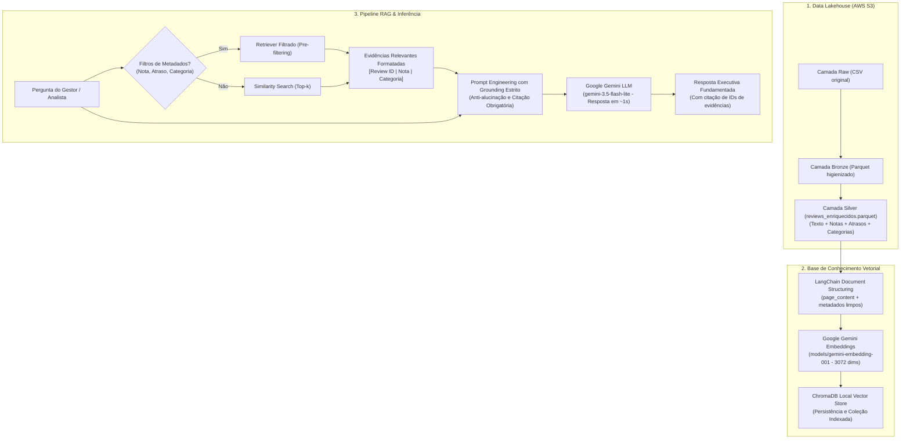

# 🎯 Tech Challenge - Fase 4: Voice of Customer Intelligence com RAG
**FIAP - Pós-Tech em Inteligência Artificial e Ciência de Dados**

Solução inteligente de **Voice of Customer (VoC)** baseada em **Retrieval-Augmented Generation (RAG)** para exploração e análise de mais de 100 mil avaliações do e-commerce brasileiro (**Brazilian E-Commerce Public Dataset by Olist**), integrando armazenamento em nuvem na **AWS S3**, banco vetorial **ChromaDB**, orquestração com **LangChain** e modelos de linguagem generativa **Google Gemini**.

---

## 📌 1. Visão Geral do Problema de Negócio

Empresas de e-commerce recebem diariamente dezenas de milhares de avaliações textuais contendo dores, elogios, frustrações com entregas e feedbacks sobre produtos. Embora as notas quantitativas (1 a 5 estrelas) apontem oscilações de satisfação, a **causa raiz** desses sentimentos reside nos dados textuais não estruturados.

### O Desafio
Permitir que gestores, diretores e analistas realizem perguntas analíticas em linguagem natural e recebam **respostas executivas fundamentadas estritamente em avaliações reais de clientes**, acompanhadas dos identificadores das evidências (`review_id`), eliminando alucinações e oferecendo rastreabilidade completa.

---

## 🏛️ 2. Arquitetura da Solução

O pipeline é composto por uma arquitetura moderna dividida em ingestão analítica (Data Lakehouse) e sistema de recuperação aumentada por IA generativa:



---

## 🛠️ 3. Tecnologias e Bibliotecas Utilizadas

| Componente | Tecnologia | Finalidade Técnica |
| :--- | :--- | :--- |
| **Orquestrador de IA** | `LangChain` (v1.4+) | Padronização com LCEL, Document abstractions e encadeamento |
| **Banco Vetorial** | `ChromaDB` (`langchain-chroma`) | Armazenamento local persistente e suporte nativo a filtros de metadados |
| **Embeddings** | `Google Gemini` (`gemini-embedding-001`) | Vetorização semântica densa de 3.072 dimensões com suporte a PT-BR |
| **LLM (Geração)** | `Google Gemini` (`gemini-3.5-flash-lite`) | Inferência ultra-rápida (< 1.5s), baixo custo e alta fidelidade contextual |
| **Armazenamento Nuvem** | `AWS S3` (`boto3`) | Arquitetura Medalhão: camadas Raw, Bronze e Silver |
| **Processamento Dados** | `Pandas`, `PyArrow`, `FastParquet` | Manipulação tabular e armazenamento colunar otimizado |
| **Engenharia de Texto** | `NLTK`, `Unidecode` | Higienização, análise exploratória e lematização comparativa |

---

## 🧬 4. Engenharia e Preparação da Base (Camada Silver)

No notebook [`fase_4/notebooks/01_EDA.ipynb`](fase_4/notebooks/01_EDA.ipynb), foi realizada a unificação relacional dos dados e enriquecimento dos comentários:

1. **Seleção e Junção Relacional**:
   - `olist_order_reviews_dataset` combinado com `olist_orders_dataset`, `olist_order_items_dataset` e `olist_products_dataset`.
2. **Engenharia de Features Logísticas**:
   - Cálculo de `dias_atraso` (`order_delivered_customer_date` vs `order_estimated_delivery_date`).
   - Criação da flag booleana `entregue_com_atraso`.
3. **Tratamento de Texto**:
   - Concatenação do título da avaliação (`review_comment_title`) com o corpo da mensagem (`review_comment_message`), criando a coluna `review_rag`.
   - Limpeza de nulos e valores ausentes nas categorias e datas.
4. **Decisão Técnica Fundamental (NLP Clássico vs. RAG)**:
   - Foram testados tratamentos clássicos de NLP (remoção de stopwords, pontuação, acentuação).
   - **Justificativa da escolha para o RAG:** Para o banco vetorial, foi preservado o **texto natural completo** (`review_rag`). Modelos modernos de embeddings neurais utilizam o contexto sintático, pontuação e palavras de ligação (ex: *"não recebi"*, *"muito bom"*) para entender com precisão a valência e a intenção do cliente, o que seria degradado se as stopwords fossem removidas.

---

## 🎯 5. Estratégia de Construção do Pipeline RAG

### 5.1 Documentos e Metadados Ricos
Cada avaliação foi convertida em um `Document` do LangChain contendo:
- **`page_content`**: Mensagem completa da avaliação em linguagem natural.
- **`metadata`**:
  - `review_id` e `order_id`: Chaves para rastreabilidade e auditoria;
  - `review_score`: Nota de 1 a 5 estrelas;
  - `product_category_name`: Categoria normalizada;
  - `entregue_com_atraso`: Indicador booleano de SLA logístico violado;
  - `dias_atraso`: Saldo em dias de atraso (positivo se atrasou, negativo se adiantou).

### 5.2 Desafio Adicional: Exploração Contextual com Metadados
Para ir além da busca semântica simples, a solução implementa **Pre-filtering de Metadados** via ChromaDB:
- **Investigação de Insatisfação:** Filtro estrito `{"review_score": {"$lte": 2}}`, garantindo que reclamações não sejam contaminadas por comentários elogiosos.
- **Investigação de Excelência:** Filtro `{"review_score": 5}` para extrair pontos fortes e boas práticas de atendimento.
- **Auditoria de Logística:** Filtro `{"entregue_com_atraso": True}` para isolar feedbacks decorrentes de falhas de transportadoras.

### 5.3 Respostas Fundamentadas e Tratamento de Alucinações
O prompt do sistema impõe regras rígidas de **Grounding**:
1. Todas as afirmações do modelo devem conter o `[Review ID: ...]` correspondente.
2. Caso o usuário faça perguntas fora do domínio ou a base não possua evidências suficientes, o sistema retorna obrigatoriamente:  
   > *"Não foram encontradas avaliações suficientes na base de conhecimento sobre este assunto."*

---

## 💬 6. Exemplos de Perguntas e Respostas

### Exemplo 1: Investigação de Problemas com Entrega
> **Pergunta:** *"O que os clientes relatam sobre problemas relacionados à entrega e prazos?"*  
> **Resposta:**  
> Os principais problemas relatados concentram-se em:
> 1. **Mercadoria não entregue após o prazo estipulado:** Clientes informam que o prazo expirou e não receberam o produto nem atualização de rastreio `[Review ID: e64fb393e7b...]`.
> 2. **Divergência de endereço ou insucesso na entrega pela transportadora:** Relatos de destinatário ausente sem tentativa real `[Review ID: 8670d52e15e...]`.

### Exemplo 2: Pergunta Fora do Escopo da Base (Guarda-Corpo / Anti-Alucinação)
> **Pergunta:** *"Qual a previsão do tempo para amanhã em São Paulo?"*  
> **Resposta:**  
> *"Não foram encontradas avaliações suficientes na base de conhecimento sobre este assunto."*

---

## 🚀 7. Instruções para Instalação e Execução

### Pré-requisitos
- Python 3.10 ou superior
- Conta no Google AI Studio (chave gratuita `GOOGLE_API_KEY`)
- Credenciais da AWS com acesso ao S3 (caso queira recarregar os dados brutos)

### Passo a Passo

1. **Clone o repositório:**
   ```bash
   git clone https://github.com/LucasRuizMartins/fiap_tech_challenge_04.git
   cd tech_challenge_04
   ```

2. **Crie e ative um ambiente virtual:**
   ```bash
   python -m venv venv
   # No Windows:
   .\venv\Scripts\activate
   # No Linux/Mac:
   source venv/bin/activate
   ```

3. **Instale as dependências:**
   ```bash
   pip install -r requirements.txt
   pip install chromadb langchain-chroma
   ```

4. **Configure as Variáveis de Ambiente:**
   Copie o arquivo `.env.example` para `.env` e preencha suas chaves:
   ```bash
   cp .env.example .env
   ```
   *Exemplo mínimo necessário no `.env`:*
   ```dotenv
   GOOGLE_API_KEY=AIzaSy...
   BUCKET_NAME=postech-challenge-datascience-004
   AWS_REGION=us-east-1
   AWS_ACCESS_KEY_ID=seu_access_key
   AWS_SECRET_ACCESS_KEY=seu_secret_key
   ```

5. **Execução dos Notebooks na Ordem:**
   - **`fase_4/notebooks/00_s3.ipynb`**: Download do Kaggle e ingestão Raw/Bronze no S3.
   - **`fase_4/notebooks/01_EDA.ipynb`**: Análise exploratória e geração da camada Silver enriquecida.
   - **`fase_4/notebooks/01_rag.ipynb`**: Construção da base vetorial ChromaDB, testes de recuperação, filtros de metadados e geração executiva com o Gemini.

---

## 📁 8. Estrutura do Repositório

```text
├── .env.example              <- Exemplo de variáveis de ambiente
├── requirements.txt          <- Dependências do projeto
├── README.md                 <- Documentação completa do projeto e arquitetura
├── src/
│   ├── __init__.py
│   └── utils.py              <- Funções de integração com AWS S3 (download/upload Parquet)
└── fase_4/
    ├── docs/
    │   └── [IAST] - Tech Challenge - Fase 4.pdf <- Edital e requisitos oficiais
    ├── models/
    │   └── chroma_db/        <- Banco vetorial ChromaDB persistido localmente
    └── notebooks/
        ├── 00_s3.ipynb       <- Ingestão no S3 (Raw e Bronze)
        ├── 01_EDA.ipynb      <- Limpeza, engenharia de dados e salvamento na camada Silver
        └── 01_rag.ipynb      <- Pipeline RAG completo (LangChain + Chroma + Gemini)
```

---

## 🎥 9. Vídeo de Apresentação
- **Link do Vídeo:** [Adicionar Link do YouTube / Loom]
- **Duração Máxima:** 7 minutos.
- **Roteiro coberto:** Problema de negócio, arquitetura proposta, justificativas de engenharia de dados (NLP clássico vs embeddings densos), demonstração prática com filtros de metadados e evidências geradas.
